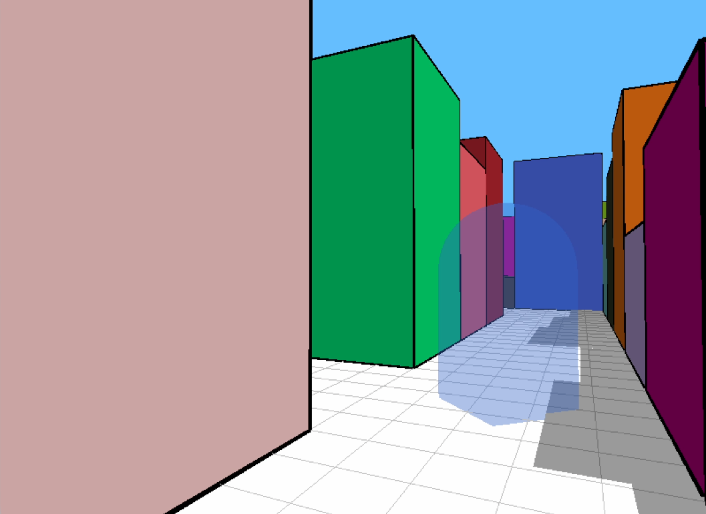

# Minos Run

A tiny first-person 3D maze race written in Python with [raylib](https://www.raylib.com).

Every level is a procedurally generated labyrinth: walls of random heights and colors cast shadows on the floor, and somewhere inside stands a yellow capsule — the exit. You are not alone: a blue capsule wanders the same corridors, looking for the exit too. Reach it first, or the level is lost. Each win makes the maze larger and the rival faster.



## About

This is a learning project: I build it to learn Python, raylib and game development in general. It started from the tutorial [Making a simple 3D game in Python (for real) with Raylib](https://www.youtube.com/watch?v=MIgq9w0MUsM) by FinFET (the original game: [aMaze Game in Python + Raylib](https://finfetchannel.itch.io/amaze-game-in-python-raylib) on itch.io) and keeps growing from there — for learning and for fun. Expect experiments: new features land here to be tried out, not to make a polished game.

## Controls

| Input | Action |
|---|---|
| <kbd>W</kbd> <kbd>A</kbd> <kbd>S</kbd> <kbd>D</kbd> | move |
| mouse | look around |
| left click | start / retry |
| <kbd>Esc</kbd> | quit |

## Running

Requires Python 3.12+ and [uv](https://docs.astral.sh/uv/):

```bash
uv sync
uv run python main.py
```

Or with plain pip: `pip install raylib && python main.py`.

## Project structure

- `main.py` — the whole game in one file (~200 lines)
- `make_sounds.py` — synthesizes `.wav` sound effects with pure Python
- `sounds/` — generated effects (tweak the script and re-run it)
- `screenshots/` — images for this README

## Roadmap

- [x] procedural maze generation (recursive backtracker)
- [x] first-person controls with collision and wall sliding
- [x] rival AI agent driven by a visit heatmap
- [x] win / lose flow, levels with growing maze and faster rival
- [ ] wire up the sound effects (files are already in `sounds/`)
- [ ] HUD: level number and timer
- [ ] curated wall palette instead of random RGB
- [ ] minimap in the corner
- [ ] best times saved between runs (JSON)
- [ ] multiple agents, a key-and-door mechanic
- [ ] hunter mode: the agent chases the player

## Known issues

- The exit sometimes spawns right at the start cell (about 0.5% of mazes, an instant win) and very rarely in a sealed-off pocket (about 0.06%, the level can't be finished).
- Maze generation is recursive and hits Python's recursion limit at around level 35 (85×85 maze).
- Collision checks test 6 points around the player instead of 8, so you can clip wall corners slightly in some directions.

## Built with

- [raylib](https://www.raylib.com) via [raylib-python-cffi](https://github.com/electronstudio/raylib-python-cffi) bindings (`import pyray`)
- Python 3.12, managed with [uv](https://docs.astral.sh/uv/)

## License

My code is released under the [MIT License](LICENSE). The game started from FinFET's tutorial and the original [aMaze](https://finfetchannel.itch.io/amaze-game-in-python-raylib); all credit for the original idea and code goes to FinFET.
